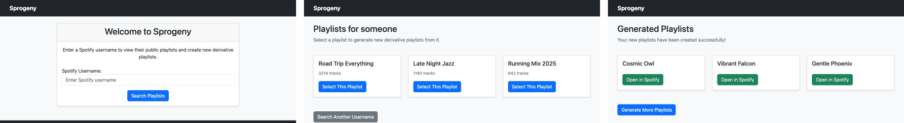

# Sprogeny

Generate new Spotify playlists from existing ones.



> [!NOTE]
> **This is the original Flask prototype.** Sprogeny has since been rebuilt in SvelteKit. That version is the live service, a proof of concept for a public service, and its code isn't public yet.
>
> Like any individual developer's Spotify app, the live service runs in Spotify's Development Mode. That means at most **5 users, each added by hand**, with Spotify Premium on the owner's account. Open public access (Extended Quota) is only for organizations whose existing service has at least 250,000 monthly active users and that pass partner vetting.
>
> This prototype predates Spotify's February 2026 API changes and isn't being updated for them. Its username search (`GET /users/{id}/playlists`) and playlist creation (`POST /users/{id}/playlists`) were removed for Development Mode apps. See [#10](https://github.com/lucidbeaming/sprogeny/issues/10).

This prototype is a small Flask app: enter a Spotify username, pick one of their public playlists, and it creates up to three new "offspring" playlists on your account, each a different shuffled slice of the original, with names like *Cosmic Owl* or *Vibrant Falcon*. It works best on very large playlists, where it surfaces tracks you'd never reach by scrolling.

## Requirements

- Python 3.9+
- A Spotify app from the [Spotify developer dashboard](https://developer.spotify.com/dashboard) (client ID and secret), with your redirect URI registered. Spotify only accepts loopback IPs for local HTTP redirects, so register `http://127.0.0.1:5000/callback` and use the same value in `.env`.
- Spotify Premium on the app owner's account, and each user (up to 5) added under **User Management** in the app's dashboard (see the warning above)

## Installation

```bash
git clone https://github.com/lucidbeaming/sprogeny.git
cd sprogeny
python -m venv venv
source venv/bin/activate  # On Windows: venv\Scripts\activate
pip install -r requirements.txt
cp .env.example .env
```

Then fill in `.env` (see [Configuration](#configuration)).

## Configuration

| Variable | Required | Default | Description |
|---|---|---|---|
| `SPOTIFY_CLIENT_ID` | Yes | — | Spotify app client ID |
| `SPOTIFY_CLIENT_SECRET` | Yes | — | Spotify app client secret |
| `SPOTIFY_REDIRECT_URI` | No | `http://localhost:5000/callback` | OAuth redirect URI; must match the one registered with Spotify (use `http://127.0.0.1:5000/callback`) |
| `FLASK_SECRET_KEY` | Recommended | random per start | Signs the session cookie; set it so sessions survive restarts |
| `FLASK_APP` | No | — | `app.py`, for `flask run` |
| `FLASK_DEBUG` | No | — | `1` for the debugger and auto-reload in development |

On first use, spotipy runs the Spotify login in your browser and saves the token to `.cache` in the project folder. That file holds a refresh token: it's gitignored, so don't share it.

## Usage

Development server:

```bash
flask run
```

Open `http://127.0.0.1:5000`, enter a Spotify username, choose a playlist, and the new playlists are created on the account you signed in with.

Production, with Gunicorn:

```bash
gunicorn wsgi:app
```

## How it works

`app.py` reads every track in the chosen playlist, shuffles the list twice, then takes three slices:

| New playlist | Slice of the shuffled tracks | Size |
|---|---|---|
| 1 | positions 1,000–2,000, every second track | up to ~500 |
| 2 | positions 2,000–3,000, every second track | up to ~500 |
| 3 | positions 400–900, every track | up to ~500 |

Each non-empty slice becomes a public playlist named from a random adjective and animal, filled in batches of 100. A source playlist needs more than 400 tracks to produce anything, and more than 2,000 to produce all three.

`generate.py` is the earlier command-line version of the same idea. It works on one hard-coded source playlist (`SOURCE_PLAYLIST_ID`), checks the OAuth scopes first, and logs each step. The web app doesn't use it.

## Related projects

- [vid2midi](https://github.com/lucidbeaming/vid2midi): generates MIDI files from brightness levels in video
- [p5-audio-visualizers](https://github.com/lucidbeaming/p5-audio-visualizers): fullscreen audio-reactive p5.js sketches

## License

[MIT](LICENSE).
